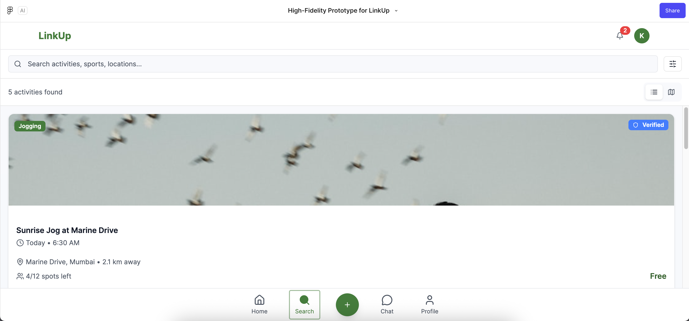
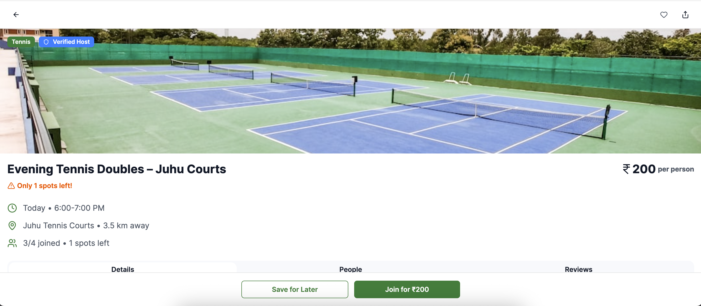
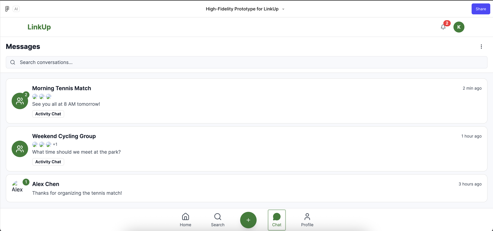

# LinkUp: Find People for Group Activities (App Prototype)

**A high-fidelity mobile app prototype that lets people post and join local group activities (a football game, a morning jog, tennis doubles) with strangers nearby.**

| Discover | Activity page | Group chat |
|---|---|---|
|  |  |  |

## Problem
Plenty of people want to play a sport or join a group run but have no one free to go with. Organisers of casual games, meanwhile, struggle to fill the last few spots.

## Solution
LinkUp matches the two sides: post an activity with time, place, skill level, spots and cost, or browse what's happening nearby and join in one tap.

## Key flows (12 screens)
1. **Onboarding & sign-up:** phone/email sign-in with OTP, location and notification permissions.
2. **Personalisation:** choose sports, set skill level per sport, set maximum distance and budget.
3. **Discover:** search and filter nearby activities, with verified-host badges and spots-left counts.
4. **Activity page:** details, people joined, reviews, "Join for ₹200" and "Save for later".
5. **Host:** create and review an activity before publishing.
6. **Social:** activity group chats and a profile with ratings, attendance and favourite sports.

## Tools
Figma (Figma Make) for the high-fidelity clickable prototype

## My role
Group project (B.Tech CSBS, Semester 7, 2025). I came up with the concept and built the high-fidelity prototype.

## Links
- Clickable prototype: https://www.figma.com/make/6spFKuaMeWx5lGuVpw8IaR/High-Fidelity-Prototype-for-LinkUp?t=tJgPGC80Ob4lb3Hz-1

## Folder contents
| Path | What it is |
|---|---|
| `screens/01_…` to `12_…` | All 12 screens in user-journey order |

## Limitations
- Concept and prototype only: no user research, market sizing or live build yet.
- **Next step:** test the core loop (post → fill spots → show up) with 10–15 players from one local football group.

---
**Shubham Tanna** · product design, UX flows, Figma
<!-- SITE_LINK:work/linkup -->
